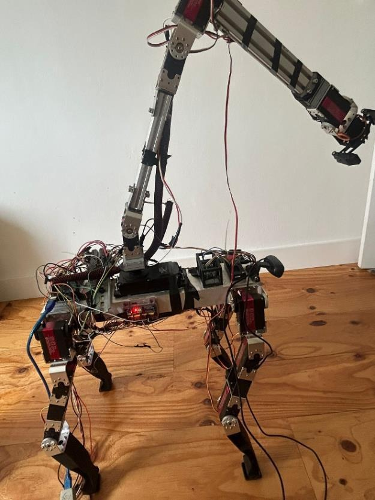
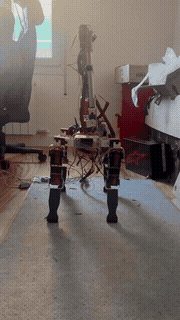
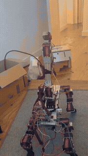
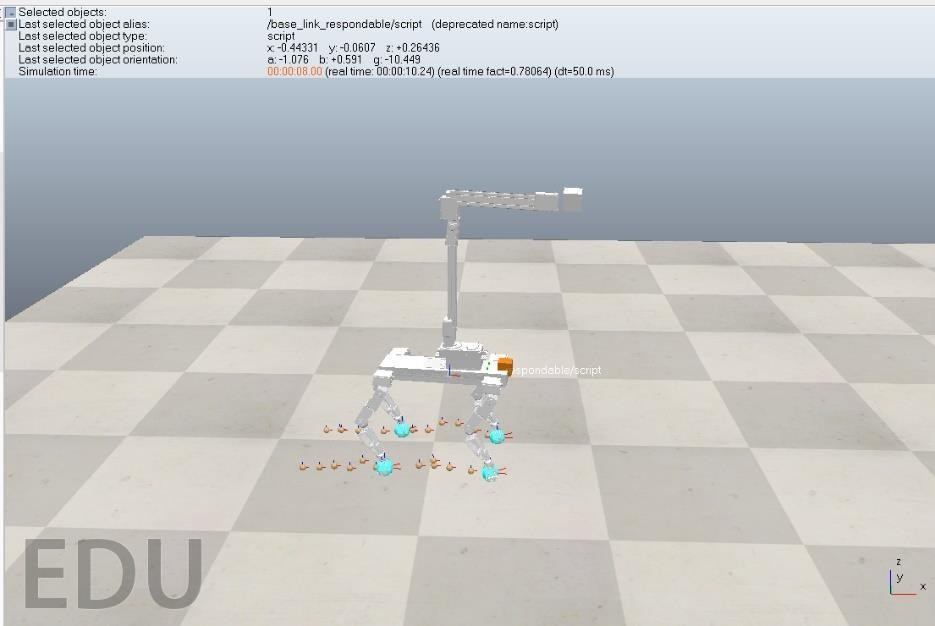
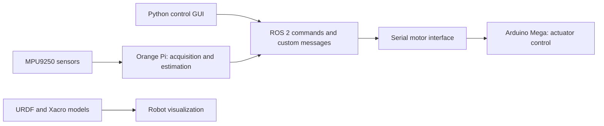

# Quadruped Robot with a 5-DOF Manipulator

**An individual master's project developed from design and modelling to a working physical prototype.**

I designed, built and programmed this quadruped-with-manipulator system as my final project for the **Master's Degree in Automatic Systems Engineering and Industrial Electronics at the Universitat Politècnica de Catalunya (UPC)**, presented in July 2025.

The project brings together robot kinematics and dynamics, static gait control, ROS 2 integration, inertial sensing and embedded actuator control.

<p align="center">
  
</p>

<p align="center">
  <a href="https://upcommons.upc.edu/entities/publication/f53c69dd-fdc5-4073-99e1-0c4ce5c5da53">UPC publication record</a> ·
  <a href="https://upcommons.upc.edu/server/api/core/bitstreams/dca027e7-d07d-412b-909c-cc20d1b1514f/content">Read the thesis (Spanish, PDF)</a> ·
  <a href="#hardware-demonstrations">Watch the demonstrations</a>
</p>

## Hardware demonstrations

Two recordings show the assembled prototype during indoor hardware trials. The previews highlight a frontal view and a view from above/rear, making the platform, legs, manipulator and onboard wiring visible.

| Frontal view | Above/rear view |
| :---: | :---: |
| [](docs/media/demo-1.mp4) | [](docs/media/demo-2.mp4) |
| [Watch full recording - 39 seconds](docs/media/demo-1.mp4) | [Watch full recording - 19 seconds](docs/media/demo-2.mp4) |

The GIFs are six-second excerpts. The MP4 versions retain the full sequence of each supplied recording, with normalized orientation, reduced resolution and no audio. These videos illustrate prototype behavior; they are not a quantitative benchmark for navigation, payload or positioning accuracy.

## My contribution

I carried out the complete project, including:

- Mechanical design and assembly of the quadruped and five-degree-of-freedom manipulator.
- Selection and integration of actuators, embedded controllers and sensors.
- Kinematic and dynamic modelling of the platform and arm.
- Static gait and manipulator motion control.
- ROS 2 software architecture, custom messages and a Python control interface.
- Orange Pi and Arduino integration, inertial data acquisition and serial communication.
- Simulation, physical prototype testing, analysis and thesis documentation.

The implementation integrates existing robotics tools, libraries and external ROS packages, whose attribution and licensing remain applicable.

## From simulation to hardware

The thesis documents modelling and simulation in **CoppeliaSim**, followed by experiments on the physical prototype. The distributed architecture uses an **Orange Pi Zero 2W** for higher-level processing and an **Arduino Mega 2560** for actuator control, with **MPU9250 inertial sensors**.

<p align="center">
  
</p>

The thesis also explores camera calibration, AprilTag-based target detection and inverse kinematics. Its discussion identifies mechanical rigidity and limited actuator feedback as constraints on positioning accuracy.

## Software components

| Package | Role |
| --- | --- |
| `quadruped_arm_motion` | Robot models, meshes, RViz configuration, launch files, motion and trajectory scripts, simulation experiments and tag pose extraction |
| `Quad_control_gui` | Python control GUI and inverse-kinematics code |
| `mpu_pub` | IMU acquisition, calibration and estimation experiments, plus serial motor communication |
| `robot_interfaces` | Custom messages for commands, joint angles, motion and sensor data |

External integrations include AprilTag, image pipeline, USB camera and teleoperation packages.



The exact node graph depends on the selected launch configuration.

## Working with the source

Use Linux with ROS 2, colcon and rosdep. The thesis describes the experimental system; a fully reproducible environment for the current repository still needs to be documented.

```bash
git clone https://github.com/Edipo3098/ros2_orange.git
cd ros2_orange
# Source your installed ROS 2 environment first.
rosdep install --from-paths src --ignore-src -r -y
colcon build --symlink-install
source install/setup.bash
```

Review the configuration notes below before using these commands. Hardware nodes can open device files during initialization.

<details>
<summary>Repository configuration notes</summary>

- URDF files are included in `src/quadruped_arm_motion/urdf/`. The name referenced by `simulation_launch.py` differs from the filenames currently stored there and must be reconciled.
- `.gitmodules` contains stale `src/src/...` entries, while the `src/teleop` gitlink lacks a corresponding entry.
- Serial settings such as `/dev/ttyS5` are embedded in source and must match the board and controller protocol.
- Experimental script variants need to be mapped to their intended runtime configurations.
- Package license placeholders need to be resolved while preserving existing third-party notices.
- Current package tests primarily cover style and documentation; functional regression tests are a development priority.

</details>

## Documentation and related work

**Thesis:** *Desarrollo e Implementación de un Sistema de Control para un Robot Cuadrúpedo con Manipulador de 5DOF* — Edinson Felipe Porras Hilarion, UPC, July 2025.

- [Official publication and supporting material](https://upcommons.upc.edu/entities/publication/f53c69dd-fdc5-4073-99e1-0c4ce5c5da53)
- [Thesis PDF](https://upcommons.upc.edu/server/api/core/bitstreams/dca027e7-d07d-412b-909c-cc20d1b1514f/content)
- [Orange Pi sensor and serial experiments](https://github.com/Edipo3098/Orange_repo)

The prototype photograph and simulation image above were extracted from the thesis (PDF pages 75 and 31). Demonstration recordings were supplied by the project author.
