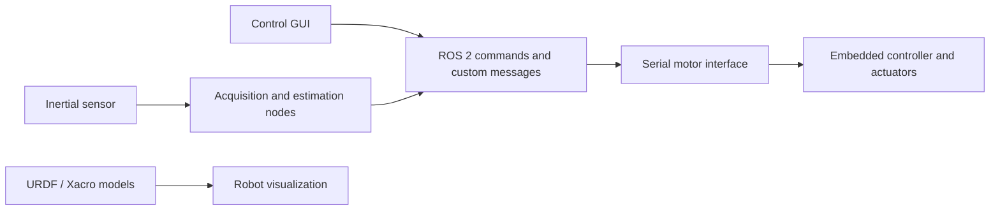

# Quadruped Robot with Manipulator — ROS 2 Workspace

Academic robotics workspace combining a quadruped platform, a robotic arm, a Python control interface, inertial sensing and serial communication with embedded hardware.

## Components

| Package | Contents |
| --- | --- |
| `quadruped_arm_motion` | Robot models, meshes, RViz configuration, launch files, motion and trajectory scripts, simulation experiments and tag pose extraction |
| `Quad_control_gui` | Python control GUI and inverse-kinematics code |
| `mpu_pub` | IMU acquisition, calibration and estimation experiments, plus serial motor communication |
| `robot_interfaces` | Custom ROS messages for commands, joint angles, motion and sensor data |

External integrations include AprilTag, image pipeline, USB camera and teleoperation code. Their presence does not establish that every integration works in the current checkout.

## Architecture



This diagram describes the main software areas in the source; the exact runtime node graph depends on the chosen launch file.

## Getting started

Use a Linux environment with ROS 2, colcon and rosdep installed. The exact validated OS, ROS distribution and hardware setup still need to be recorded.

```bash
git clone https://github.com/Edipo3098/ros2_orange.git
cd ros2_orange
```

Before building, resolve the dependency and launch issues listed below. Once the workspace configuration is repaired, the standard build sequence is:

```bash
# Source your installed ROS 2 environment first.
rosdep install --from-paths src --ignore-src -r -y
colcon build --symlink-install
source install/setup.bash
```

These commands are a build outline, not a verified clean-install recipe. Hardware nodes may open device files immediately.

## Current limitations

- The README and execution instructions are being reconstructed from source; physical hardware and simulation have not been validated during this documentation update.
- `simulation_launch.py` references `quadruped_arm_robot_Control_effort.urdf`, which is absent from the current tree. Select the intended model before using that launch file.
- `.gitmodules` contains stale `src/src/...` paths, while the `src/teleop` gitlink has no matching entry. Reconcile the dependency list before recursive submodule initialization.
- Serial settings such as `/dev/ttyS5` are embedded in source. They must match the board and controller protocol.
- Several scripts are experimental variants. Their names alone do not establish which implementation is the final one.
- Package metadata still contains license placeholders. Preserve existing third-party notices and resolve licensing before redistribution.

## Demonstration and project context

A video, hardware diagram, final TFM reference, exact personal contribution and measured results should be added with verified project information. No performance or autonomy claims are made here.

Related hardware experiments: [Orange_repo](https://github.com/Edipo3098/Orange_repo).

## Development priorities

1. Record the validated board, OS, ROS distribution and final runtime configuration.
2. Repair dependency declarations and provide one launch command for visualization without hardware.
3. Add a short demonstration and document the message flow and controller protocol.
4. Parameterize device settings and improve serial error handling.
5. Add functional tests for message conversion, communication failures and kinematics.

The current package test directories primarily contain style and documentation checks; hardware behavior needs separate validation.
